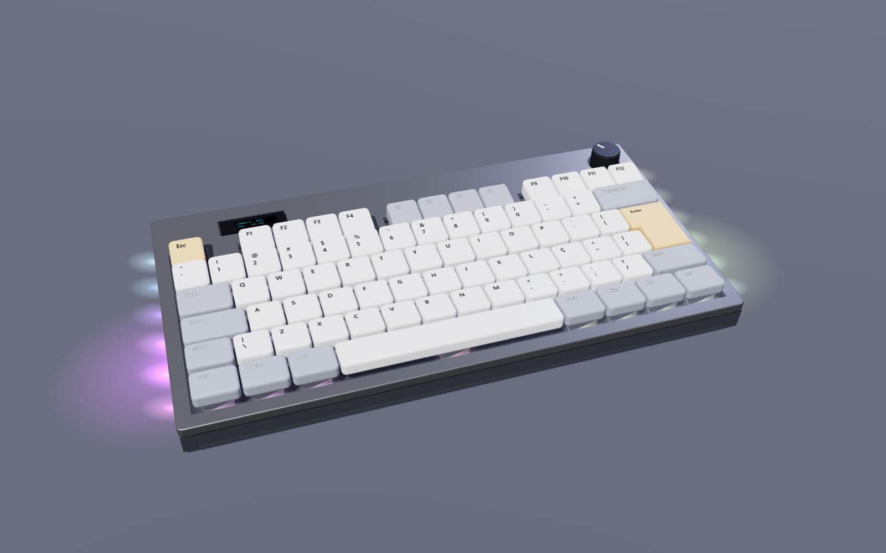
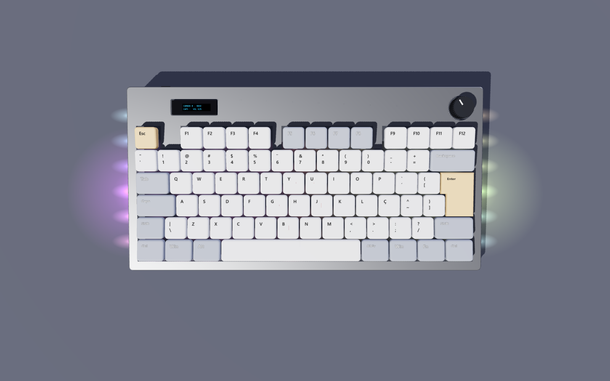
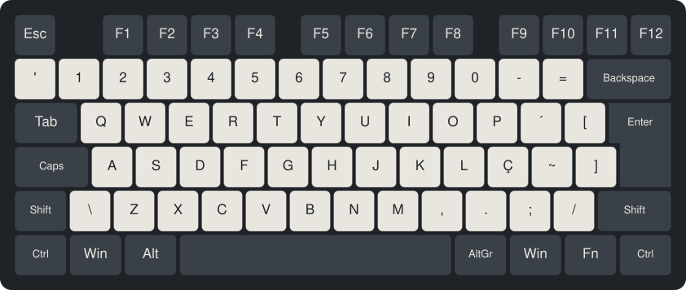
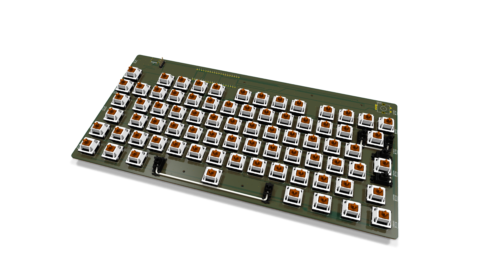
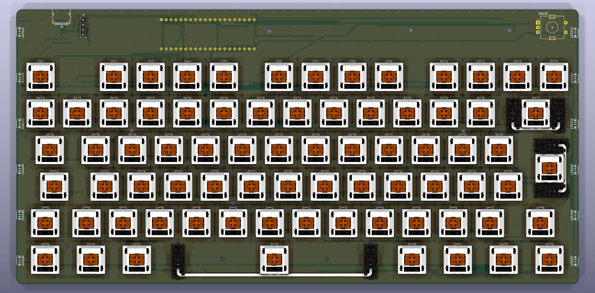
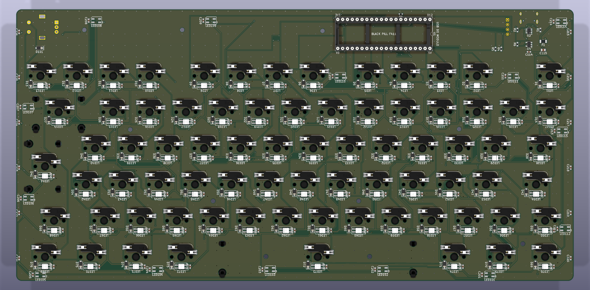
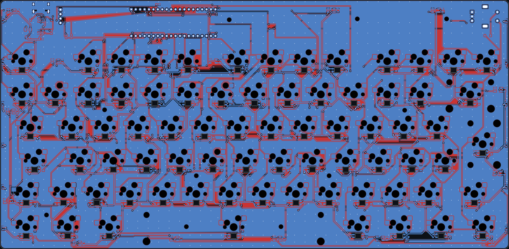

# Teclado 60% ABNT2 com fileira F

Teclado mecânico próprio: layout **60% ABNT2 com fileira de funções** (76 teclas), switches **hot-swap**,
**RGB por tecla + underglow + iluminação lateral**, **knob** e conector para **OLED**. O cérebro é uma
**Black Pill STM32F411** encaixada num soquete no verso da placa, pensada para rodar **QMK**.

A placa foi feita no **KiCad 10** quase toda **por script** (posicionamento, roteamento, acabamento e
correções), sem desenhar à mão no editor. Os scripts estão em [`hardware/tools/`](hardware/tools).



> **Status:** projeto da placa concluído e revisado (DRC sem erros), **ainda não fabricado**. Firmware QMK
> ainda não escrito. Pendências em [Antes de fabricar](#antes-de-fabricar).

---

## Conceito

Como o teclado deve ficar montado (esboço 3D feito antes da placa; o case ainda não existe):



- **Case em cunha** com 6° de inclinação, fechado nas laterais, e **moldura superior** que abre janelas só em
  volta de cada grupo de teclas (Esc, F1–F4, F5–F8, F9–F12, bloco principal).
- **OLED** à esquerda e **knob** à direita, na faixa acima da fileira F, rentes à moldura.
- Keycaps **perfil Cherry**, com acentos em Esc e Enter.
- **Underglow** por baixo e **rasgo de RGB nas laterais**, na altura da placa, com acrílico fosco por dentro.
- Pés traseiros dobráveis em 2 níveis.

---

## Layout



- 76 teclas: alfanumérico ABNT2 completo (`Ç`, `´`, `~`, `[`, `]`, `\`, `;`, `/`) + Esc e F1–F12.
- Enter ISO, Shift esquerdo curto (1,25u) por causa da tecla `\`.
- Sem setas nem coluna de navegação (não é 65%): setas, Del, Home/End e afins ficam numa camada no `Fn`.
- Fonte do layout: [`hardware/layout/teclado-kle.json`](hardware/layout/teclado-kle.json). Abra em
  [keyboard-layout-editor.com](http://www.keyboard-layout-editor.com) (*Raw data* → colar).

## A placa



| Frente | Verso |
|---|---|
|  |  |

Roteamento (vermelho = frente, azul = verso + plano de GND), com o acabamento das trilhas em retas e 45°:



### Especificações

| Item | Detalhe |
|---|---|
| Placa | 292 × 143 mm, 2 camadas, 1,6 mm, cantos com raio de 3 mm |
| Fixação | 10 furos M2 |
| Matriz | 6 linhas × 14 colunas, diodo 1N4148W (SOD-123) por tecla, catodo na linha |
| Switches | Cherry MX e compatíveis, soquete **Kailh hot-swap** (sem solda) |
| Estabilizadores | Cherry MX de placa: 2u (Backspace, Enter) e 6,25u (Espaço) |
| Microcontrolador | **WeAct Black Pill V3.x (STM32F411)** num soquete DIP-40, no verso |
| USB | USB-C (HRO TYPE-C-31-M-12), resistores CC de 5,1k, ESD USBLC6-2SC6, fusível de 500 mA |
| Knob | Encoder EC11 com clique (o clique entra na matriz em ROW0 × COL13) |
| Tela | Conector de 4 pinos para OLED I²C (GND, VCC, SCL, SDA) |

### Iluminação (102 LEDs endereçáveis numa cadeia só)

| Grupo | LEDs | Peça |
|---|---|---|
| Por tecla | LED1–LED76 | SK6812MINI-E, montagem reversa (brilha através do switch) |
| Underglow | LED101–LED114 | 14× SK6812MINI no verso, virados para a mesa |
| Laterais | LED201–LED212 | 12× SK6812SIDE-A na borda, apontando para fora |

Cada LED tem o próprio capacitor de 100 nF. O sinal de dados sai do STM32 (3,3 V) e passa por um
**74AHCT1G125**, que converte para 5 V antes de entrar na cadeia.

### Pinos da Black Pill usados

| Função | Pino |
|---|---|
| Dados do RGB | PA8 |
| OLED (I²C) | PB6 (SCL), PB7 (SDA) |
| Knob (A/B) | PA0, PA1 |

O mapa completo de linhas e colunas está no esquemático ([`hardware/teclado.pdf`](hardware/teclado.pdf)).

## Estrutura do repositório

```
hardware/
├── teclado.kicad_pro / .kicad_sch / .kicad_pcb   projeto KiCad 10 (abra o .kicad_pro)
├── matriz.kicad_sch, mcu.kicad_sch,
│   leds.kicad_sch, leds_extra.kicad_sch           folhas do esquemático
├── teclado.kicad_dru                              regras de DRC próprias (LED reverso, alívio térmico)
├── teclado.kicad_sym, teclado.pretty/             símbolo e footprint próprios (LED lateral)
├── teclado.pdf                                    esquemático em PDF
├── layout/teclado-kle.json                        layout no formato KLE
├── tools/                                         scripts que geraram a placa
└── REVISAO.md                                     revisão antes de fabricar
docs/img/                                          imagens deste README (geradas pelo kicad-cli)
```

## Como a placa foi feita

O fluxo inteiro roda pelo Python do KiCad (`C:\Program Files\KiCad\10.0\bin\python.exe`) e pelo
`kicad-cli`, com o KiCad fechado:

1. **Esquemático:** matriz e LEDs por teclas gerados pelo [kbplacer](https://github.com/adamws/kicad-kbplacer)
   a partir do KLE (`kbplacer.py`, `import_kbplacer.py`); folha do MCU (`gen_mcu_sheet.py`) e dos LEDs
   extras (`gen_leds_extra.py`) gerados por script.
2. **Placa:** contorno (`new_board.py`), sincronização com o esquemático sem abrir o editor (`sync_pcb.py`),
   posicionamento de switches, diodos, LEDs e estabilizadores pelo KLE (`place_keys.py`), eletrônica da faixa
   superior (`place_strip.py`), LEDs extras (`place_extra_leds.py`) e furação (`place_holes.py`).
3. **Roteamento:** exportação para o [FreeRouting](https://github.com/freerouting/freerouting) sem os planos
   de GND (`export_dsn.py`), importação do resultado e criação dos planos (`post_route.py`), fechamento das
   ligações que sobraram (`route_rest.py`, `open_pairs.py`).
4. **Acabamento:** trilhas em retas + 45° mantendo as mesmas pontas (`align45.py`), correções de DRC
   (`fix_drc.py`), ilhas de GND (`gnd_islands.py`) e costura dos planos com vias (`stitch_gnd.py`).

## Antes de fabricar

Resumo de [`hardware/REVISAO.md`](hardware/REVISAO.md):

- **OLED:** conferir a ordem dos pinos do módulo comprado (o header é GND-VCC-SCL-SDA). Invertido, o módulo
  cai em cima do USB-C.
- **LED lateral:** o footprint foi feito à mão. As funções dos pinos batem com o datasheet; o lado físico
  (espelhamento) ainda não foi confirmado.
- **Corrente:** 102 LEDs em branco total puxam ~3,7 A, e o fusível é de 500 mA. O firmware **precisa**
  limitar o brilho (~10% em branco, ~30% em efeitos coloridos).
- **Black Pill no verso:** o soquete com o módulo ocupa ~12–14 mm abaixo da placa (o case precisa dessa
  folga), e os botões BOOT0/NRST ficam para baixo: fazer a primeira gravação antes de fechar o case.
  Nunca ligar o USB do módulo e o da placa ao mesmo tempo.

## Próximos passos

- [ ] Fechar as pendências acima e gerar os Gerbers
- [ ] Fabricar e montar
- [ ] Firmware QMK (matriz, camada `Fn`, RGB com limite de corrente, knob, OLED)
- [ ] Case
